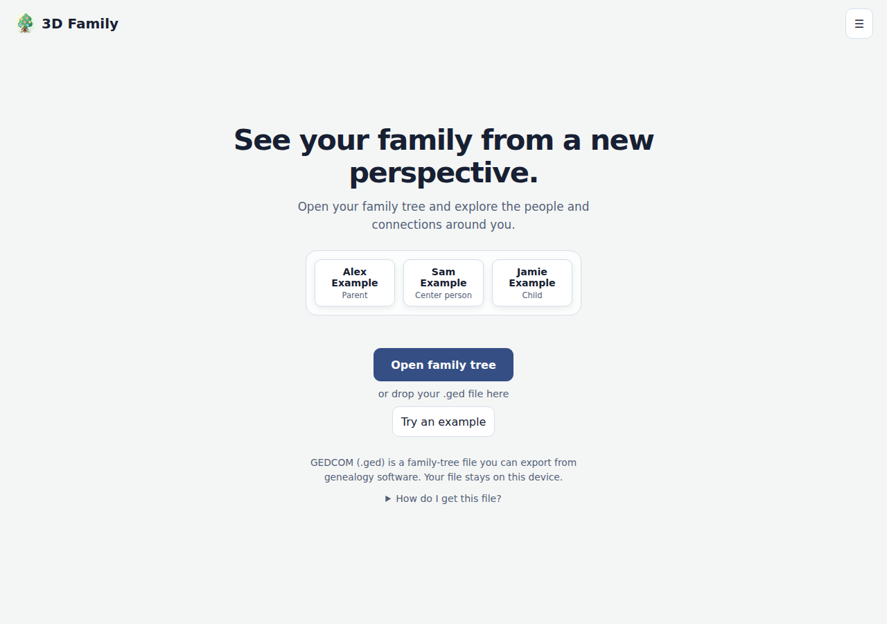

# 3D Family

Explore the people and relationships in a family tree as an interactive 3D view.

**[Open 3D Family](https://iricigor.github.io/3dfamily/)**

## Get started

Open the app and choose a GEDCOM (`.ged`) file exported from your genealogy
software, or select **Try an example** to explore the sample family. Your file
is read in your browser and stays on your device.

Choose a person to see their relatives, then rotate or pan the view, zoom in
and out, and select another person to explore a different part of the tree.
The view can include parents, siblings, partners, children, and other nearby
generations.
